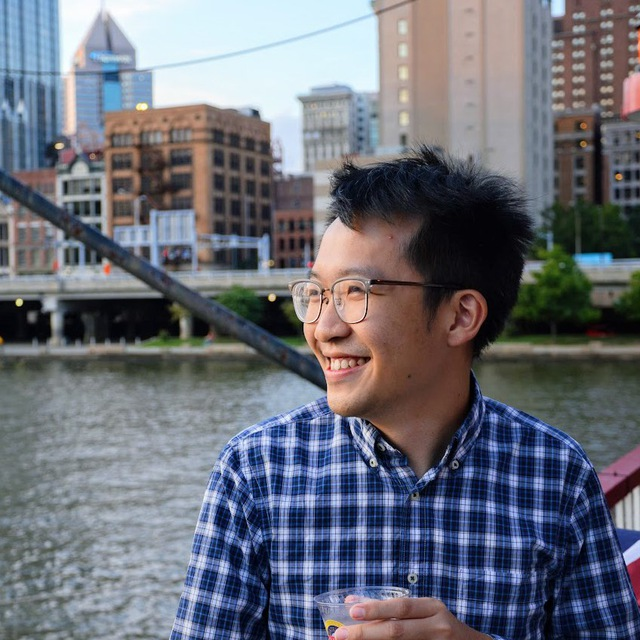

  
  

    <h1>Wong Wai Tuck</h1>
    
Head of Labs Engineering at <a href="https://watchtowr.com/">watchTowr</a> &middot; PhD Candidate at <a href="https://www.smu.edu.sg/">SMU</a>

  

Hello! I am Wai Tuck, a part-time PhD candidate at the School of Computing and Information Systems at Singapore Management University and the Head of Labs Engineering at [watchTowr](https://watchtowr.com/). My interests are wide, but primarily lie in game theory, mechanism design, machine learning and their intersection with cybersecurity. I am lucky to be co-advised by [Arunesh Sinha](http://aruneshsinha.net/) and [Sun Jun](https://sunjun.site/), who are experts in this area.

I graduated with top honours with a **Bachelor of Science in Information Systems** (2nd major in Applied Statistics) from Singapore Management University. My [undergraduate research](https://ieeexplore.ieee.org/document/8166695) was the research and implementation of a tool to analyze syntactic dependencies of software to measure change effort required for a proposed change in a given codebase. I performed empirical analysis to see if the heuristic holds for several large open source Java programs. The tool was later adapted to teach students design patterns in software engineering. My advisor, Kevin Steppe encouraged me to take it up and guided me through every step of the research process, and I am grateful for the introduction to research at such an early stage in my academic career.

I later took a **Master of Science in Information Security** from the [Information Networking Institute](https://www.cmu.edu/ini/) at Carnegie Mellon University as part of the SMU-CMU Fast-Track program. My [graduate research](/docs/master_thesis.pdf) at CMU looked at studying and using dynamic taint analysis to find bugs in node.js, in particular to find code injection vulnerabilities in packages in the NPM ecosystem. I was advised by [Limin Jia](https://www.andrew.cmu.edu/user/liminjia/), and had the guidance and help from a PhD student, [Darion Cassel](https://darioncassel.me/), that made the research project a success.

In my free time, I play CTFs. I currently play with the amazing folks at [Black Bauhinia](https://ctftime.org/team/83678/). Previously, I played with [CTF.SG](https://ctftime.org/team/77768) and [Tea MSG](https://ctftime.org/team/154535/), a team I co-founded with a couple of amazing friends. We won our first [DEFCON Black Badge](https://www.defcon.org/html/links/dc-black-badge.html) in 2018 at the Red Alert ICS CTF in DEFCON 26. During my masters, I was fortunate to have played with the [Plaid Parliament of Pwning](https://www.cmu.edu/ini/news/2019/defcon-champion20191.html) back at Carnegie Mellon University.

I also do martial arts, and am an avid fan of Bruce Lee, hence the title of the blog :)

## Certifications

<ul class="cert-list">
  <li>
    <a href="https://www.credly.com/badges/9c78ec69-eb4c-4342-83b8-8410ecdb9746/public_url"><strong>Offensive Security Certified Professional (OSCP)</strong></a>
    Summer 2016
  </li>
  <li>
    <a href="https://www.credly.com/badges/8e10a1c6-817e-4ed0-b8ec-be65f2915846/public_url"><strong>Offensive Security Certified Expert (OSCE)</strong></a>
    Spring 2018
  </li>
  <li>
    <a href="https://www.credly.com/badges/dadae944-20b5-4782-a6af-f5e36b40260e/public_url"><strong>Offensive Security Web Expert (OSWE)</strong></a>
    Summer 2019
  </li>
  <li>
    <a href="https://www.credly.com/badges/09974b47-1ca7-41d2-b298-5ad0f3b84d59/public_url"><strong>Offensive Security Wireless Professional (OSWP)</strong></a>
    Summer 2019
  </li>
  <li>
    <a href="https://www.credly.com/badges/c248e8e2-fb76-447c-84c3-a6b850a179d8/public_url"><strong>Splunk Core Certified User</strong></a>
    Summer 2019
  </li>
  <li>
    <a href="https://coursera.org/verify/specialization/MR5ZNKP93EM3"><strong>Deep Learning Specialization</strong></a>
    Summer 2021
  </li>
  <li>
    <a href="https://certificates.blackhat.com/28819646-b564-45e2-adbf-b04575b19603#acc.HZBcloGI"><strong>Windows Vulnerability Research &amp; Fuzzing (Black Hat)</strong></a>
    Spring 2022
  </li>
  <li>
    <strong>Machine Learning in Production</strong>
    Summer 2022
  </li>
  <li>
    <a href="https://www.credly.com/badges/b91b5622-142c-46aa-92ee-c7ce54322e94/public_url"><strong>MITRE ATT&CK Fundamentals</strong></a>
    Summer 2024
  </li>
</ul>

## Contact

You may find a copy of my CV [here](/docs/CV.pdf). You may also contact me at `me(at)waituck(dot)sg`.

As always, hack on!
